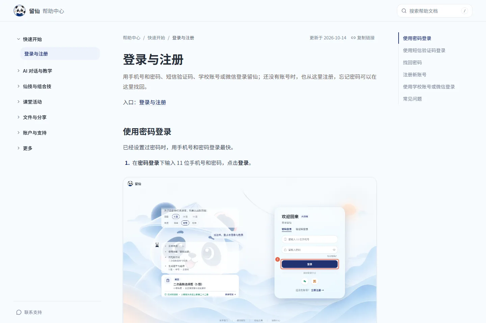
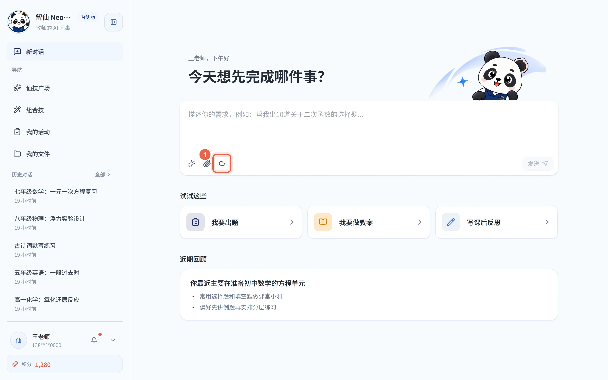
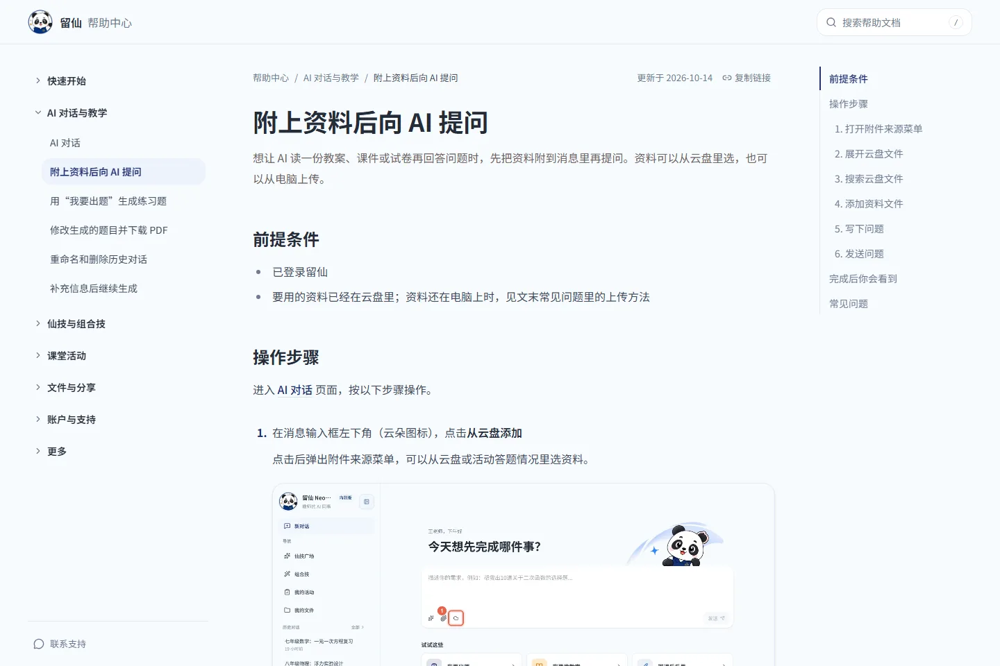
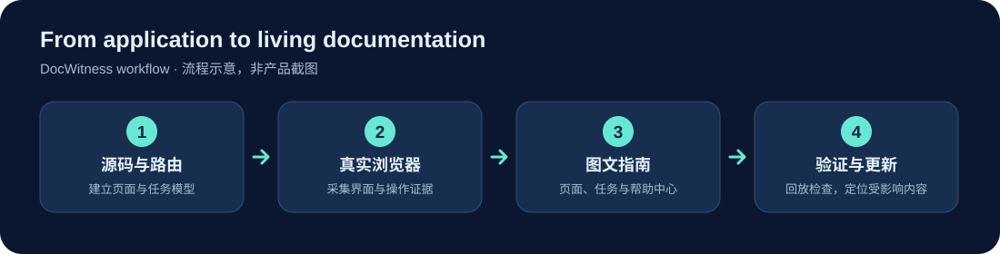

<div align="center">
  
  <h1>DocWitness</h1>
  <h2>Your app changes. Your docs keep up.</h2>
  <p>让使用手册跟上产品的每一次变化。</p>
  <p>AI 探索真实应用，生成有据可查、持续更新的图文使用手册。</p>
  <p><strong>AI Skill</strong> · <strong>Playwright</strong> · <strong>Next.js</strong> · <strong>React Router</strong> · <strong>Vue Router</strong></p>
  <p>
    <a href="https://liuxian.neostaredu.com/help">查看真实帮助中心</a> ·
    <a href="#quick-start">快速开始</a> ·
    <a href="#documentation">阅读文档</a>
  </p>
</div>

## See It in Action — 留仙

以下画面来自[留仙帮助中心](https://liuxian.neostaredu.com/help)，展示已经公开的图文手册。帮助中心有分类导航、页面说明和按目标组织的任务指南；任务步骤引用真实浏览器采集的标注截图。

<div align="center">
  <a href="https://liuxian.neostaredu.com/help">
    
  </a>
  <p><sub>帮助中心页面：登录与注册</sub></p>
</div>

| 真实标注截图 | 完整任务指南 |
| :---: | :---: |
| <a href="https://liuxian.neostaredu.com/help/tasks/ask-with-material"></a> | <a href="https://liuxian.neostaredu.com/help/tasks/ask-with-material"></a> |
| 从真实应用画面标出操作入口 | [查看“附上资料后向 AI 提问”](https://liuxian.neostaredu.com/help/tasks/ask-with-material) |

留仙 · AI 教学助手是 DocWitness 的真实应用案例。[打开帮助中心](https://liuxian.neostaredu.com/help)，查看页面说明与任务指南。手册的结构和证据要求见[分类图文手册](docs/GROUPED_MANUAL.md)与[标注覆盖率](docs/ANNOTATION_COVERAGE.md)。

## Why DocWitness?

| | 对使用手册的价值 |
| --- | --- |
| **真实浏览器** | 在 Chromium 中观察页面和已授权的操作，截图来自实际渲染结果。 |
| **证据优先** | 步骤顺序、控件名称、截图和完成标志由结构化模型与采集证据约束；缺少证据时阻断正式发布。 |
| **发布边界** | 演示数据、敏感内容与写操作经过门禁；未授权的提交、删除或支付请求不会被自动执行。 |
| **持续维护** | 根据源码依赖定位受影响的手册，并用浏览器回放检查页面变化。 |

DocWitness 当前支持扫描 **Next.js App Router / Pages Router**、**React Router 6 / 7 data mode 的对象路由**（如 `createBrowserRouter`）和 **Vue Router 4 的路由表**（含 `.vue` 单文件组件依赖），Vite 项目也适用。静态扫描确定不了的路由会被列出来，可以由 AI 补充候选或人工登记，不会默默漏掉。它能生成页面说明、任务指南，也能将 Markdown 转成静态帮助中心。其他框架会收到明确的暂不支持提示。

## How It Works

<div align="center">
  
</div>

源码与路由建立页面和任务模型；浏览器采集操作证据；AI 在事实约束下撰写说明；发布前校验，后续按变化增量更新。上图是**工作流程示意**，不是产品截图。

## Quick Start

需要 **Node.js 20.9.0+** 和可启动的 Chromium。先获取工具：

```bash
git clone https://github.com/YuRonin/docwitness.git
cd docwitness
npm ci
npx playwright install chromium
```

### Use as a Skill

把仓库链接到 Claude Code 或 Codex 的 `manual` Skill 目录，再在目标 Web 项目（Next.js、React Router 或 Vue Router）里提出目标：

> 为这个项目建立图文使用手册，先检查环境并扫描页面。发布前让我确认任务范围。

安装链接命令和各平台步骤见[安装与接入](docs/GETTING_STARTED.md)。Skill 调用名为 `manual`；可使用 `/manual-init`（Claude Code）或 `$manual-init`（Codex）等别名。

### Use as a CLI

从工具仓库运行，指定目标项目：

```bash
node bin/manual.js doctor --project-root /path/to/your-nextjs-app
node bin/manual.js init --project-root /path/to/your-nextjs-app --base-url http://localhost:3000
node bin/manual.js inspect --project-root /path/to/your-nextjs-app
```

随后需要根据源码补充页面用途与操作，再采集和生成。完整顺序见[安装与接入](docs/GETTING_STARTED.md)和[使用与维护](docs/USAGE.md)。

## Output Structure

默认在**目标项目**中生成：

```text
.manual/                       配置、模型、运行记录和本地中间产物
docs/manual/index.md           手册目录
docs/manual/<page-id>.md       页面说明
docs/manual/tasks/<task-id>.md 任务指南
docs/manual/images/annotated/ 通过发布校验的标注截图
docs/manual/meta.json          更新时间和相关文章
```

运行 `manual site` 可将已生成的 Markdown 转为静态帮助中心。只有通过发布校验的截图才进入正式文档。

## Documentation

| 阅读目的 | 文档 |
| --- | --- |
| 安装、Skill 链接、CLI 首次接入、登录 | [安装与接入](docs/GETTING_STARTED.md) |
| 生成、更新、核对、输出与常用命令 | [使用与维护](docs/USAGE.md) |
| Run 状态、恢复、缓存与冲突 | [Runtime 使用说明](docs/RUNTIME.md) |
| 任务、分类页面与手册写法 | [分类图文手册](docs/GROUPED_MANUAL.md) |
| Fixture、隐私、截图及网络规则 | [Demo Capture](docs/DEMO_CAPTURE.md) |
| 架构与扩展约定 | [架构文档](docs/ARCHITECTURE.md) |

## Contributing & License

欢迎通过 [Issue](https://github.com/YuRonin/docwitness/issues) 反馈问题或建议；开发和验证方式见[参与贡献](CONTRIBUTING.md)。项目采用 [MIT License](LICENSE)。
